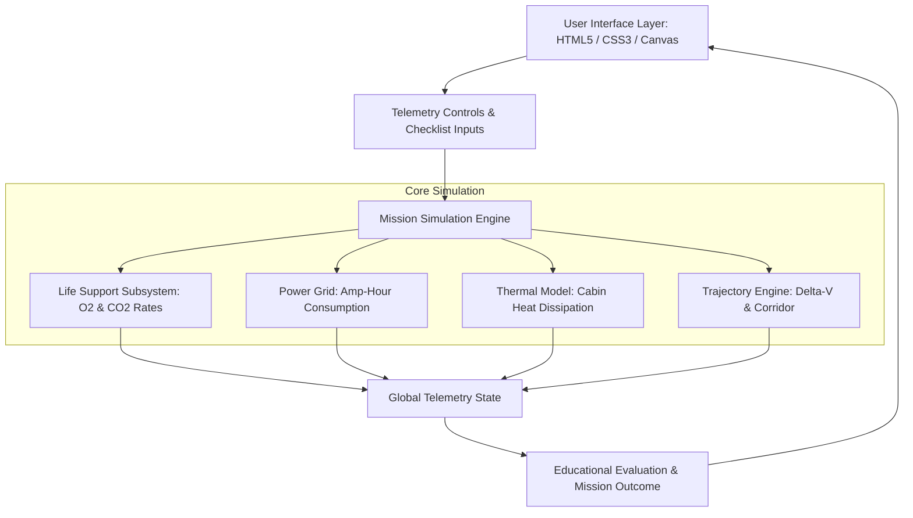

# Junior Astronaut Mission Trainer

**Live Deployment:** [https://voiruz.github.io/app-for-education/](https://voiruz.github.io/app-for-education/)  
**Event:** NASA Space Apps Challenge 2026 — Nagpur  
**Organizers:** WCEM, ICTRD (AstraVeda Initiative), in collaboration with NASA  

---

## 1. Project Title & Problem Statement

### Project Title
**Junior Astronaut Mission Trainer: Apollo 13 "Home Safe" Experience**

### Challenge
**NASA Space Apps Challenge 2026:** [Build a Junior Astronaut Mission Trainer](https://www.spaceappschallenge.org/2026/challenges/junior-astronaut-mission-trainer/?tab=details)  
- **Target Audience:** Beginner, Youth, and Intermediate Learners  
- **Subject Areas:** Space Exploration, Life Support Systems (ECLSS), Orbital Trajectory, Software, Gamified STEM Education  

### Problem Statement
Standard space STEM educational resources frequently polarize into two extremes: either trivializing mission engineering into surface-level trivia or presenting equations with overwhelming complexity. As a result, students miss the critical experiential lesson of aerospace engineering: balancing interdependent, life-critical constraints under strict deadlines.

### Our Solution
The Junior Astronaut Mission Trainer is an interactive, browser-based simulation platform inspired by the historic Apollo 13 survival mission ("NASA's most successful failure"). Students take command of both the crew cabin and Mission Control telemetry, actively managing real physical parameters:
- Oxygen supply and carbon dioxide ($CO_2$) filtration rates
- Severe electrical power budgets (amp-hours)
- Cabin thermal equilibrium
- Course-correction burns and atmospheric reentry corridors

Through five narrative-driven mission chapters, learners experience the real trade-offs and decisive problem-solving required to bring astronauts safely home.

---

## 2. Team Details

**Team Name:** Base8  
**Local Event:** NASA Space Apps Challenge — Nagpur (Wainganga College of Engineering & Management)  

| Member Name | Home Institution | GitHub Username | Role & Engineering Focus |
|---|---|---|---|
| Neel Tawre | G.H. Raisoni University | [@nirukun](https://github.com/nirukun) | Full-Stack Architecture & State Management |
| Sanket Paradkar | G.H. Raisoni University | [@geeksanket](https://github.com/geeksanket) | Mission Narrative, STEM Curriculum & Research |
| Viral Bodbe | G.H. Raisoni University | [@Viral-Bodbe](https://github.com/Viral-Bodbe) | Full-Stack Architecture & State Management |
| Gauri Choudhary | G.H. Raisoni University | [@gaurichoudhary](https://github.com/gaurichoudhary) | Mission Narrative, STEM Curriculum & Research |
| Dharti Charpe | S.B.Jain Institute of Management & Technology | [@dharticharpe](https://github.com/dharticharpe) | Mission Narrative, Testing, Parameter Validation & Quality Assurance |

*Per Nagpur Participant Handbook Rule 4, each registered team member contributes directly with verified personal commits.*

---

## 3. Solution Overview & Architecture

### Functional Overview
The platform structures the historical Apollo 13 crisis into five progressive interactive scenarios:
1. **The Crisis (Oxygen Tank Rupture):** Diagnostic alarm handling, Command Module (*Odyssey*) emergency shutdown, and Lunar Module (*Aquarius*) lifeboat activation.
2. **Survival & Life Support:** The "Mailbox" adapter assembly (fitting square LiOH canisters into round sockets) and severe electrical power rationing.
3. **Trajectory & Navigation:** Lunar free-return trajectory calculations and manual engine burn alignment using Earth's day/night terminator.
4. **Cold-Cockpit Resurrection:** Executing the checklist sequence to repower the frozen Command Module using limited battery reserves.
5. **Atmospheric Entry & Splashdown:** Managing the narrow 6.5-degree reentry corridor, heat-shield thermal load, and radio blackout timing.

### System Architecture



### Technology Stack
- **Frontend / Client:** Semantic HTML5, Modern CSS (Responsive Grid/Flexbox), JavaScript (ES6+)
- **Simulation State Machine:** Modular event-driven JavaScript state manager
- **Physics / Subsystem Math:** Empirical telemetry equations derived from historical Apollo 13 flight logs
- **Version Control & Hosting:** Git, GitHub, and GitHub Pages

---

## 4. Live Demo & Screenshots

- **Live Application:** [https://voiruz.github.io/app-for-education/](https://voiruz.github.io/app-for-education/)
- **Demonstration Video:** *[Project Walkthrough Video](https://voiruz.github.io/app-for-education/)*
- **Repository:** [https://github.com/VOIRUZ/app-for-education](https://github.com/VOIRUZ/app-for-education)

### Interface Preview

| Mission Telemetry Dashboard | Subsystem Control & Scrubber Challenge |
|---|---|
| *(Real-time vitals, consumable gauges, alarm status)* | *(Step-by-step checklist and improvised engineering)* |

---

## 5. Installation & Setup Guide

The application runs entirely in modern web browsers without external database or heavyweight runtime dependencies.

### Prerequisites
- Modern web browser (Chrome, Edge, Firefox, or Safari)
- Git (for cloning the repository)
- Optional: Local HTTP server (Node `http-server`, Python `http.server`, or VS Code Live Server)

### Local Setup Steps

1. **Clone the repository:**
   ```bash
   git clone https://github.com/VOIRUZ/app-for-education.git
   cd app-for-education
   ```

2. **Run locally using Python:**
   ```bash
   python -m http.server 8000
   ```
   *Or using Node.js:*
   ```bash
   npx serve .
   ```

3. **Open the application:**
   Navigate to `http://localhost:8000` in your web browser.

---

## 6. AI Usage Disclosure

In compliance with Section 5 ("AI Usage & Disclosure Policy") of the NASA Space Apps Challenge Nagpur 2026 Official Participant Handbook:

### AI Tools and Models Used
- **Primary AI Tool:** Google Gemini via Antigravity Agent Workspace
- **Model Used:** **Gemini 3.8 Flash**

### Model Justification
The **Gemini 3.8 Flash** model was selected for the following technical reasons:
1. **Low Latency & High Iteration Speed:** During the 48-hour overnight hackathon window, rapid response times allowed continuous brainstorming, formula validation, and quick markdown structuring without stalling sprint momentum.
2. **STEM & Aerospace Physics Comprehension:** Gemini 3.8 Flash demonstrates strong reasoning capabilities when translating complex aerospace concepts (Apollo 13 life-support consumables, lithium hydroxide absorption, electrical discharge rates) into simplified, pedagogically sound game rules.
3. **Strict Policy & Rulebook Adherence:** The model accurately synthesized and incorporated the six mandatory sections, commit rules, and formatting standards required by the Nagpur local host handbook.
4. **Token Efficiency:** It provides high throughput and dependable reasoning within compact prompt contexts, ideal for fast iterative development.

### Component-Level Transparency
| Component / Task | AI Contribution | Human Engineering & Verification |
|---|---|---|
| **Mission Scenario Ideation** | Generated Apollo 13 incident outlines and milestone breakdowns | Selected educational learning objectives and historical fidelity checks |
| **Subsystem Mathematics** | Suggested baseline decay formulas for $CO_2$ and power consumption | Tuned parameters, balanced difficulty levels, and validated units |
| **Documentation & README** | Assisted in drafting structured sections according to the handbook | Authored team details, customized architecture diagrams, and verified rules |
| **Code Structure & Boilerplate** | Provided scaffolding suggestions for modular state management | Authored implementation code, integrated UI components, and debugged |

### Zero AI Authorship Confirmation
- No AI tools or bots are registered as repository contributors or git commit authors.
- All git commits are strictly authored and committed by registered human team members using verified personal credentials.

---

## References & Data Sources

- [NASA Space Apps Challenge 2026 - Challenge Details](https://www.spaceappschallenge.org/2026/challenges/junior-astronaut-mission-trainer/?tab=details)
- [NASA History - Apollo 13 Flight Journal & Chronology](https://www.nasa.gov/history/apollo-13/)
- [NASA Environmental Control and Life Support System (ECLSS)](https://www.nasa.gov/international-space-station/space-station-environmental-control-and-life-support-system/)
- [NASA Technical Reports Server (NTRS) - Apollo 13 Review Board Report](https://ntrs.nasa.gov/)
